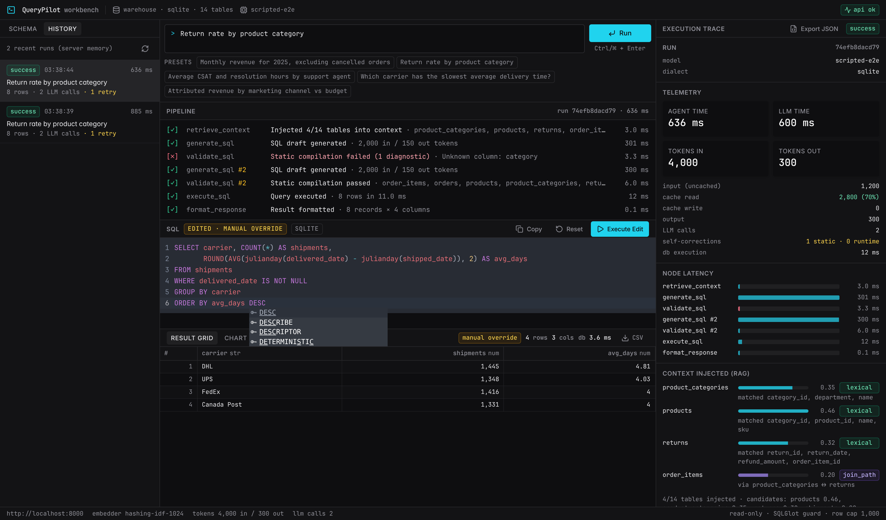
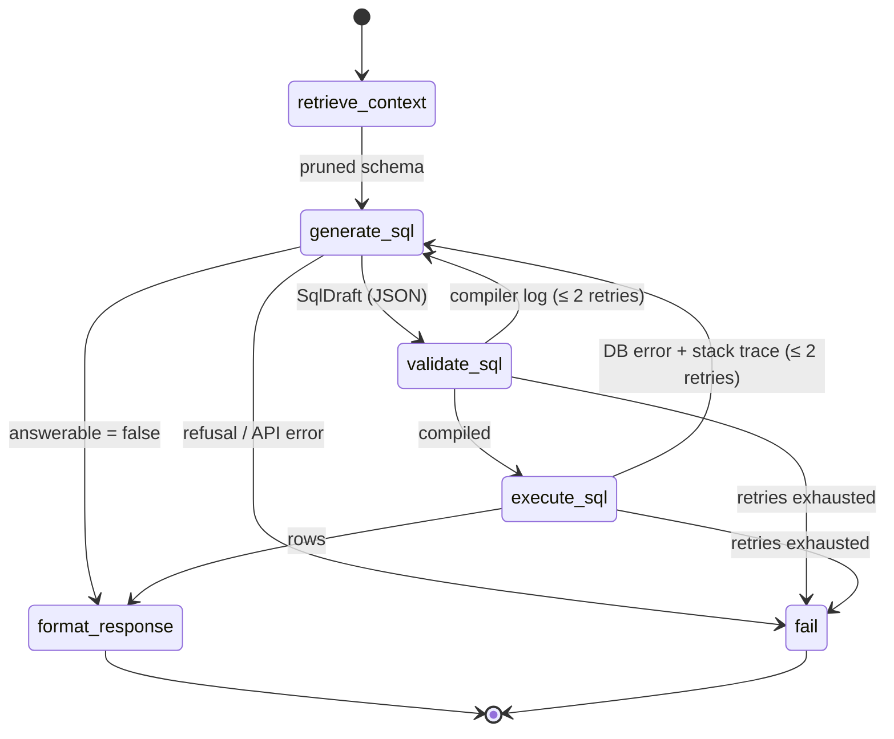

# QueryPilot Workbench

[](https://github.com/Aryan23G/Aryan23G.github.io/actions/workflows/workbench.yml)


[](LICENSE)

**Ask a business question in plain English and get back validated, read-only SQL, the result set, and a full audit trail of how the agent got there.**

A deterministic Text-to-SQL agent: a **LangGraph** state machine drives **Claude** structured generation, a **SQLGlot** static compiler checks every query against the real schema before it runs, **SQLAlchemy** executes on a connection that cannot write, and **Qdrant** retrieves only the tables a question needs. A dense three-pane **Next.js** workbench shows every step live.


<sub>Captured from the real UI and API with the scripted test generator standing in for Claude (`tests/e2e_server.py`). Its first draft deliberately references a non-existent column so the self-correction loop is visible.</sub>

## Features

- **Deterministic agent loop.** Five states (retrieve, generate, compile, execute, format) with pure routing functions. The model never decides control flow.
- **Self-correction with budgets.** Compiler errors and database errors go back to the model with the exact log or stack trace: at most 2 static and 2 runtime retries.
- **Static SQL compiler.** One read-only statement, AST-wide write/DDL denylist, table allowlist, and column binding against the live schema, so hallucinated columns fail before the database sees them.
- **Read-only by construction.** Read-only connection/transaction, statement timeout, row cap, and the guard. The manual-override editor goes through the same path.
- **Schema RAG.** Table- and column-level vectors in Qdrant, lexical pinning, and foreign-key join-path closure, so the prompt carries 4-7 of 14 tables instead of all of them.
- **Observability.** OpenTelemetry span per node (Langfuse/OTLP or OpenLLMetry), plus the same trace in the UI: tokens and cache hits, per-node latency, injected tables with scores, reasoning chain, every correction, JSON export.
- **Operable API.** SSE streaming, run history, optional bearer auth, per-client rate limiting and a concurrent-run cap.
- **Tested.** 103 backend tests (mypy strict), 16 frontend unit tests, and Playwright end-to-end and accessibility suites against the real API. A 20-question execution-accuracy benchmark is included.

<p align="center"></p>

## Quick start

```bash
cd workbench
cp backend/.env.example backend/.env      # add ANTHROPIC_API_KEY
docker compose --env-file backend/.env up --build   # UI on http://localhost:3000, API on :8000
```

Running without Docker, the test commands, and every setting are covered in [Running it](#running-it) and [`backend/.env.example`](backend/.env.example).

## File tree

```
workbench/
├── docker-compose.yml               qdrant + api + web
├── backend/                         Python 3.11+ · FastAPI · LangGraph
│   ├── pyproject.toml               deps, ruff, mypy (strict), pytest config
│   ├── .env.example
│   ├── Dockerfile
│   ├── app/
│   │   ├── main.py                  FastAPI app factory + lifespan
│   │   ├── config.py                typed settings (QP_* env vars)
│   │   ├── container.py             composition root: engine, index, generator, graph, runner
│   │   ├── api/
│   │   │   ├── routes.py            public /api/health + protected routes (see API)
│   │   │   ├── security.py          bearer auth, sliding-window rate limit, concurrent-run cap
│   │   │   └── schemas.py           request/response contracts
│   │   ├── agent/
│   │   │   ├── state.py             AgentState (TypedDict + reducers), SqlDraft, telemetry models
│   │   │   ├── graph.py             StateGraph wiring + pure routing functions
│   │   │   ├── nodes.py             States 1-5 + fail node (spans, live step events)
│   │   │   ├── llm.py               SqlGenerator protocol + ClaudeSqlGenerator (structured outputs)
│   │   │   ├── prompts.py           cached system prompt, bounded per-attempt user prompt
│   │   │   ├── runner.py            runs the graph in a task, streams events, builds RunTrace
│   │   │   └── history.py           bounded in-memory store of recent RunTraces
│   │   ├── rag/
│   │   │   ├── documents.py         introspection → TableMeta → table/column documents
│   │   │   ├── embeddings.py        FastEmbed (bge-small) + offline hashing/IDF embedder
│   │   │   └── store.py             Qdrant index, score aggregation, FK join-path closure
│   │   ├── sql/
│   │   │   ├── guard.py             SQLGlot static compiler (State 3)
│   │   │   └── executor.py          read-only engine, timeouts, row cap, structured errors (State 4)
│   │   ├── observability/
│   │   │   └── tracing.py           OpenTelemetry / Langfuse (OTLP) / OpenLLMetry setup + node spans
│   │   └── db/
│   │       ├── catalog.py           semantic data dictionary for the sample warehouse
│   │       └── seed.py              deterministic 14-table sample warehouse
│   ├── eval/
│   │   ├── questions.json           20 questions (easy/medium/hard) with gold SQL
│   │   ├── compare.py               execution-accuracy comparator
│   │   └── run.py                   `python -m eval.run`: live evaluation (needs ANTHROPIC_API_KEY)
│   └── tests/                       103 tests (pytest) + e2e_server.py (real API, scripted generator)
└── frontend/                        Next.js 14 (App Router) · Tailwind · shadcn/ui · Tremor · CodeMirror 6
    ├── app/                         layout.tsx, page.tsx, globals.css (dark IDE tokens)
    ├── components/
    │   ├── ui/                      shadcn primitives: button, badge, tabs, collapsible, resizable, scroll-area, tooltip, textarea
    │   └── workbench/
    │       ├── workbench.tsx        3-pane resizable layout, title bar, status bar
    │       ├── schema-browser.tsx   left: schema browser, RAG-injected tables marked with reason/score
    │       ├── history-list.tsx     left: recent runs, reopen into canvas + trace
    │       ├── query-input.tsx      center: fixed request input + presets
    │       ├── step-tracker.tsx     center: linear [✓]/[⚙]/[✗]/[ ] state-machine tracker
    │       ├── sql-editor.tsx       center: CodeMirror SQL canvas + "Execute Edit" manual override
    │       ├── results-table.tsx    center: TanStack grid (sortable, typed) + Tremor chart + CSV
    │       └── trace-panel.tsx      right: tokens, latency, RAG context, reasoning chain, corrections, JSON export, event log
    ├── hooks/use-agent-run.ts       run-state reducer (SSE events, history reload, manual override)
    ├── lib/                         api.ts (typed client + auth), sse.ts (frame parser), types.ts, utils.ts
    ├── tests/                       16 unit tests (Vitest): reducer, SSE parser, CSV/formatting, auth header
    ├── e2e/                         Playwright: workflow (6) + accessibility (2 + 1 tracked fixme) against the real API
    └── playwright.config.ts         starts tests/e2e_server.py + a production Next build
```

## Architecture



Control flow is decided only by pure routing functions over typed state (`agent/graph.py`). The model never chooses the next step.

| State | Node | What happens |
|---|---|---|
| 1 | `retrieve_context` | Vector search over table **and** column documents in Qdrant → per-table score aggregation → lexical pinning of tables named in the question → relative cutoff → FK-neighbour relaxation → **FK join-path closure** (adds bridge tables such as `order_items` between `returns` and `products`). Only these tables' DDL goes into the prompt. |
| 2 | `generate_sql` | Claude returns a schema-validated `SqlDraft` (`reasoning_chain`, `sql_query`, `tables_used`, `answerable`, `clarification`) through structured outputs. System prompt is static per dialect and prompt-cached; every retry is a fresh, bounded prompt that carries all failed attempts with their logs. |
| 3 | `validate_sql` | SQLGlot parses in the target dialect, requires one read-only statement, walks the AST for write/DDL/session nodes (including data-modifying CTEs) and denylisted functions, checks tables against the catalogue, **qualifies every column against the real schema** (hallucinated columns fail here, before the DB), and injects an outer `LIMIT`. Failures produce a compiler-style log. |
| 4 | `execute_sql` | SQLAlchemy engine whose connections cannot write: SQLite opened `mode=ro` + `PRAGMA query_only`; Postgres `SET TRANSACTION READ ONLY` + `statement_timeout`; transaction always rolled back. Statement deadline (SQLite progress handler), `fetchmany` row cap, structured error + trimmed stack trace for self-correction. |
| 5 | `format_response` | Rows → array of objects + typed column metadata + row count, truncation flag and DB latency. |

**Streaming.** `/api/query/stream` emits Server-Sent Events: `run_started`, `step` (running → done/error, with a small payload: the draft SQL and injected tables as soon as they exist), and `run_completed` with the full `RunTrace`. The graph runs in its own asyncio task, so a client disconnect cancels the run.

**Manual override.** `/api/execute` sends user-edited SQL through exactly the same SQLGlot compiler and read-only executor. No LLM is involved, and the guard is never bypassed.

## API

| Method | Path | Auth | Notes |
|---|---|---|---|
| GET | `/api/health` | public | model, dialect, table count, active embedder, index collection |
| GET | `/api/schema` | token | databases, tables, columns, keys, sample values |
| POST | `/api/query` | token, rate-limited, run slot | run to completion, returns `RunTrace` |
| POST | `/api/query/stream` | token, rate-limited, run slot | Server-Sent Events: `run_started`, `step`, `run_completed`, `run_error` |
| POST | `/api/execute` | token, rate-limited | manual override through the guard + read-only executor (no LLM) |
| GET | `/api/runs` | token | recent run summaries, newest first |
| GET | `/api/runs/{run_id}` | token | full `RunTrace` (404 once evicted); the UI's JSON export uses this |

"token" applies only when `QP_API_TOKEN` is set (401 + `WWW-Authenticate: Bearer` otherwise). Rate limit: 429 + `Retry-After`. Run slots: 503 + `Retry-After` when `QP_MAX_CONCURRENT_RUNS` runs are in flight. A streaming run holds its slot until the stream ends. Rate limits, run slots and history are in-process: with several workers, enforce limits at the gateway and swap `RunStore` for a shared store.

## Observability

Every run produces one trace:

```
agent.run                         outcome, llm_calls, static/runtime retries, gen_ai.usage.*
├── agent.node.retrieve_context   rag.selected_tables, rag.candidates
├── agent.node.generate_sql       agent.attempt, agent.trigger, gen_ai.usage.*
│   └── anthropic.messages.create   ← emitted by the Anthropic SDK itself (native OTel)
├── agent.node.validate_sql       sql.compile.ok, sql.compile.diagnostics
├── agent.node.generate_sql       agent.trigger = static_error      ← self-correction cycle
├── ...
└── agent.node.execute_sql        db.rows, db.elapsed_ms, db.error_type
```

| `QP_OTEL_EXPORTER` | Use |
|---|---|
| `otlp` | Any OTLP/HTTP backend. **Langfuse**: `QP_OTEL_ENDPOINT=https://cloud.langfuse.com/api/public/otel`, `QP_OTEL_HEADERS=Authorization=Basic <base64(pk:sk)>`. Also Jaeger, Tempo, Honeycomb, Datadog. |
| `traceloop` | **OpenLLMetry** auto-instrumentation (`pip install '.[openllmetry]'`). It patches the Anthropic SDK, so the SDK's native spans are switched off to avoid duplicate LLM spans. |
| `console` | Print spans locally. |
| `none` | Default. |

The same data is returned to the UI in `RunTrace`: token usage (including cache reads/writes), per-node latency, injected tables with scores, reasoning chain, every correction log, and per-call request IDs.

## Running it

**Backend**

```bash
cd workbench/backend
python -m venv .venv && . .venv/bin/activate
pip install -e ".[dev,fastembed]"
cp .env.example .env    # set ANTHROPIC_API_KEY (all QP_* settings are listed there)
uvicorn app.main:app --reload --port 8000
```

On first start the sample warehouse (`data/warehouse.db`, 14 tables, ~37k rows) is generated and the schema is indexed into an embedded Qdrant store under `data/qdrant`. Point `QP_DATABASE_URL` at your own database to use it instead; the index is keyed by a schema fingerprint and rebuilt only when the schema changes.

**Frontend**

```bash
cd workbench/frontend
npm ci
NEXT_PUBLIC_API_URL=http://localhost:8000 npm run dev    # http://localhost:3000
```

**Everything (Docker)**

```bash
cd workbench
ANTHROPIC_API_KEY=sk-ant-... docker compose up --build
```

## Tests and quality gates

```bash
cd backend  && ruff check app tests eval && mypy app eval && pytest -q    # 103 tests, mypy --strict
cd frontend && npm run typecheck && npm run lint && npm test && npm run build
cd frontend && npm run e2e    # Playwright: starts the API (scripted generator, auth on) + a production build
```

Set `E2E_PYTHON` to the backend's Python interpreter if it isn't on `PATH` as `python`.

The test suite needs no network. A scripted `SqlGenerator` replaces Claude, so every routing path is exercised deterministically: happy path, static retry (with the compiler log in the next prompt), static budget exhaustion, runtime retry (with the stack trace), runtime budget, write attempts that never reach the DB, unanswerable questions, and refusals. Separate tests cover:
- the exact Claude request (structured-output schema, effort, cache control, refusal-fallback beta) against a mocked HTTP transport,
- the read-only connection with the guard bypassed,
- the statement timeout,
- retrieval quality and FK join-path closure,
- SSE framing,
- the OpenTelemetry span tree,
- auth (401), rate limiting (429), the concurrency cap (503) and slot release after streaming,
- run history and the eval set (every gold query compiles through the guard and returns rows).

The browser suite covers a self-correcting run, the manual override, a blocked `DROP TABLE`, run history and JSON export, the unauthenticated-request check, landmarks/labels, and a keyboard-only run.

**Evaluation.** `ANTHROPIC_API_KEY=... python -m eval.run [--model ...] [--only h]` runs the 20-question benchmark through the real agent and writes an accuracy report (by difficulty, latency, self-corrections, tokens) to `eval/results/`. It costs real API tokens and has not been run in this repository yet, so no accuracy figure is claimed.

CI: `.github/workflows/workbench.yml`.

## Design notes and limits

- **Model.** Claude Opus 5.5 by default (`QP_ANTHROPIC_MODEL`), `effort=medium`, adaptive thinking (always on for this model), structured outputs, and server-side refusal fallback (`fallbacks: "default"`, not used on Haiku).
- **Embeddings.** Production uses FastEmbed `BAAI/bge-small-en-v1.5` (local ONNX, no API). If the model can't be loaded, for example because there's no network on first start, the service logs a warning and falls back to the built-in IDF-weighted hashing embedder. `/api/health` reports which one is active. The retrieval tests run on the hashing embedder; bge-small retrieval quality has not been benchmarked in this repo.
- **Retries** are bounded separately for static (`QP_MAX_STATIC_RETRIES`, default 2) and runtime (`QP_MAX_RUNTIME_RETRIES`, default 2) failures.
- **Embedded Qdrant** is single-process. Run Qdrant as a server (`QP_QDRANT_URL`) for multiple API workers.
- The read-only guarantees are layered: SQLGlot guard, then the read-only connection/transaction, then the timeout and row cap. For production, also connect with a database role that only has `SELECT` grants.
- **Auth** is a single shared bearer token. `NEXT_PUBLIC_API_TOKEN` is compiled into the browser bundle, so it suits an internal tool; put SSO or another user-auth proxy in front for anything wider.

## Roadmap

- **Accuracy report.** Run `python -m eval.run` against Claude and publish execution accuracy by difficulty, plus a model comparison (Opus / Sonnet / Haiku).
- **Grid virtualization.** Replace the Radix tabs in the results pane with plain controls, then window the rows. Virtualizing inside Radix Tabs re-rendered endlessly under the React 19 runtime that Next 14 bundles.
- **Accessibility.** A custom CodeMirror `HighlightStyle` with AA contrast for every SQL token, and editor-owned scrolling. Then enable the all-states axe test (currently `test.fixme` in `frontend/e2e/a11y.spec.ts`).
- **Conversation.** Follow-up questions that carry the previous question and SQL into the next run, and clarifying questions for ambiguous metrics.
- **Scale-out.** Run history in a database and limits enforced at the gateway, so several API workers share state. CI coverage on Postgres.

## License

[MIT](LICENSE) © Aryan Gupta
