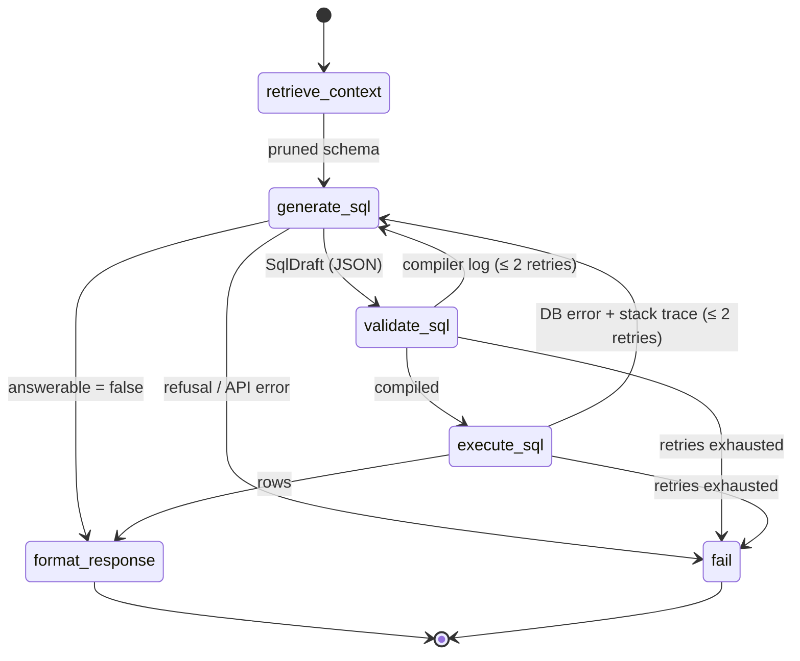

# QueryPilot Workbench

A deterministic Text-to-SQL agent system: **LangGraph** state machine + **Claude** structured generation + **SQLGlot** static compilation + read-only **SQLAlchemy** execution + **Qdrant** schema RAG, behind a **FastAPI** service, with a dense three-pane **Next.js** workbench for auditing every step.

> The static, in-browser [QueryPilot demo](../querypilot/) is a separate, lighter project. This directory is the self-hosted, production-shaped system.

## File tree

```
workbench/
├── docker-compose.yml               qdrant + api + web
├── backend/                         Python 3.11+ · FastAPI · LangGraph
│   ├── pyproject.toml               deps, ruff, mypy (strict), pytest config
│   ├── .env.example
│   ├── Dockerfile
│   ├── app/
│   │   ├── main.py                  FastAPI app factory + lifespan
│   │   ├── config.py                typed settings (QP_* env vars)
│   │   ├── container.py             composition root: engine, index, generator, graph, runner
│   │   ├── api/
│   │   │   ├── routes.py            /api/health · /api/schema · /api/query · /api/query/stream (SSE) · /api/execute
│   │   │   └── schemas.py           request/response contracts
│   │   ├── agent/
│   │   │   ├── state.py             AgentState (TypedDict + reducers), SqlDraft, telemetry models
│   │   │   ├── graph.py             StateGraph wiring + pure routing functions
│   │   │   ├── nodes.py             States 1-5 + fail node (spans, live step events)
│   │   │   ├── llm.py               SqlGenerator protocol + ClaudeSqlGenerator (structured outputs)
│   │   │   ├── prompts.py           cached system prompt, bounded per-attempt user prompt
│   │   │   └── runner.py            runs the graph in a task, streams events, builds RunTrace
│   │   ├── rag/
│   │   │   ├── documents.py         introspection → TableMeta → table/column documents
│   │   │   ├── embeddings.py        FastEmbed (bge-small) + offline hashing/IDF embedder
│   │   │   └── store.py             Qdrant index, score aggregation, FK join-path closure
│   │   ├── sql/
│   │   │   ├── guard.py             SQLGlot static compiler (State 3)
│   │   │   └── executor.py          read-only engine, timeouts, row cap, structured errors (State 4)
│   │   ├── observability/
│   │   │   └── tracing.py           OpenTelemetry / Langfuse (OTLP) / OpenLLMetry setup + node spans
│   │   └── db/
│   │       ├── catalog.py           semantic data dictionary for the sample warehouse
│   │       └── seed.py              deterministic 14-table sample warehouse
│   └── tests/                       71 tests: guard, executor, RAG, graph routing, API/SSE, LLM request shape, tracing
└── frontend/                        Next.js 14 (App Router) · Tailwind · shadcn/ui · Tremor · CodeMirror 6
    ├── app/                         layout.tsx, page.tsx, globals.css (dark IDE tokens)
    ├── components/
    │   ├── ui/                      shadcn primitives: button, badge, tabs, collapsible, resizable, scroll-area, tooltip, textarea
    │   └── workbench/
    │       ├── workbench.tsx        3-pane resizable layout, title bar, status bar
    │       ├── schema-browser.tsx   left: schema tree, RAG-injected tables marked with reason/score
    │       ├── query-input.tsx      center: fixed request input + presets
    │       ├── step-tracker.tsx     center: linear [✓]/[⚙]/[✗]/[ ] state-machine tracker
    │       ├── sql-editor.tsx       center: CodeMirror SQL canvas + "Execute Edit" manual override
    │       ├── results-table.tsx    center: TanStack grid (sortable, typed) + Tremor chart + CSV
    │       └── trace-panel.tsx      right: tokens, latency, RAG context, reasoning chain, corrections, event log
    ├── hooks/use-agent-run.ts       SSE event reducer + manual override
    └── lib/                         api.ts (typed client + POST SSE reader), types.ts, utils.ts
```

## Architecture



Control flow is decided only by pure routing functions over typed state (`agent/graph.py`). The model never chooses the next step.

| State | Node | What happens |
|---|---|---|
| 1 | `retrieve_context` | Vector search over table **and** column documents in Qdrant → per-table score aggregation → lexical pinning of tables named in the question → relative cutoff → FK-neighbour relaxation → **FK join-path closure** (adds bridge tables such as `order_items` between `returns` and `products`). Only these tables' DDL goes into the prompt. |
| 2 | `generate_sql` | Claude returns a schema-validated `SqlDraft` (`reasoning_chain`, `sql_query`, `tables_used`, `answerable`, `clarification`) through structured outputs. System prompt is static per dialect and prompt-cached; every retry is a fresh, bounded prompt that carries all failed attempts with their logs. |
| 3 | `validate_sql` | SQLGlot parses in the target dialect, requires one read-only statement, walks the AST for write/DDL/session nodes (including data-modifying CTEs) and denylisted functions, checks tables against the catalogue, **qualifies every column against the real schema** (hallucinated columns fail here, before the DB), and injects an outer `LIMIT`. Failures produce a compiler-style log. |
| 4 | `execute_sql` | SQLAlchemy engine whose connections cannot write: SQLite opened `mode=ro` + `PRAGMA query_only`; Postgres `SET TRANSACTION READ ONLY` + `statement_timeout`; transaction always rolled back. Statement deadline (SQLite progress handler), `fetchmany` row cap, structured error + trimmed stack trace for self-correction. |
| 5 | `format_response` | Rows → array of objects + typed column metadata + row count, truncation flag and DB latency. |

**Streaming.** `/api/query/stream` emits Server-Sent Events: `run_started`, `step` (running → done/error, with a small payload: the draft SQL and injected tables as soon as they exist), and `run_completed` with the full `RunTrace`. The graph runs in its own asyncio task, so a client disconnect cancels the run.

**Manual override.** `/api/execute` sends user-edited SQL through exactly the same SQLGlot compiler and read-only executor. No LLM is involved, and the guard is never bypassed.

## Observability

Every run produces one trace:

```
agent.run                         outcome, llm_calls, static/runtime retries, gen_ai.usage.*
├── agent.node.retrieve_context   rag.selected_tables, rag.candidates
├── agent.node.generate_sql       agent.attempt, agent.trigger, gen_ai.usage.*
│   └── anthropic.messages.create   ← emitted by the Anthropic SDK itself (native OTel)
├── agent.node.validate_sql       sql.compile.ok, sql.compile.diagnostics
├── agent.node.generate_sql       agent.trigger = static_error      ← self-correction cycle
├── ...
└── agent.node.execute_sql        db.rows, db.elapsed_ms, db.error_type
```

| `QP_OTEL_EXPORTER` | Use |
|---|---|
| `otlp` | Any OTLP/HTTP backend. **Langfuse**: `QP_OTEL_ENDPOINT=https://cloud.langfuse.com/api/public/otel`, `QP_OTEL_HEADERS=Authorization=Basic <base64(pk:sk)>`. Also Jaeger, Tempo, Honeycomb, Datadog. |
| `traceloop` | **OpenLLMetry** auto-instrumentation (`pip install '.[openllmetry]'`). It patches the Anthropic SDK, so the SDK's native spans are switched off to avoid duplicate LLM spans. |
| `console` | Print spans locally. |
| `none` | Default. |

The same data is returned to the UI in `RunTrace`: token usage (including cache reads/writes), per-node latency, injected tables with scores, reasoning chain, every correction log, and per-call request IDs.

## Running it

**Backend**

```bash
cd workbench/backend
python -m venv .venv && . .venv/bin/activate
pip install -e ".[dev,fastembed]"
cp .env.example .env    # set ANTHROPIC_API_KEY
uvicorn app.main:app --reload --port 8000
```

On first start the sample warehouse (`data/warehouse.db`, 14 tables, ~37k rows) is generated and the schema is indexed into an embedded Qdrant store under `data/qdrant`. Point `QP_DATABASE_URL` at your own database to use it instead; the index is keyed by a schema fingerprint and rebuilt only when the schema changes.

**Frontend**

```bash
cd workbench/frontend
npm ci
NEXT_PUBLIC_API_URL=http://localhost:8000 npm run dev    # http://localhost:3000
```

**Everything (Docker)**

```bash
cd workbench
ANTHROPIC_API_KEY=sk-ant-... docker compose up --build
```

## Tests and quality gates

```bash
cd backend  && ruff check app tests && mypy app && pytest -q      # 71 tests, mypy --strict
cd frontend && npm run typecheck && npm run lint && npm run build
```

The test suite needs no network. A scripted `SqlGenerator` replaces Claude, so every routing path is exercised deterministically: happy path, static retry (with the compiler log in the next prompt), static budget exhaustion, runtime retry (with the stack trace), runtime budget, write attempts that never reach the DB, unanswerable questions, and refusals. Separate tests cover:
- the exact Claude request (structured-output schema, effort, cache control, refusal-fallback beta) against a mocked HTTP transport,
- the read-only connection with the guard bypassed,
- the statement timeout,
- retrieval quality and FK join-path closure,
- SSE framing,
- the OpenTelemetry span tree.

CI: `.github/workflows/workbench.yml`.

## Design notes and limits

- **Model.** Claude Opus 5.5 by default (`QP_ANTHROPIC_MODEL`), `effort=medium`, adaptive thinking (always on for this model), structured outputs, and server-side refusal fallback (`fallbacks: "default"`, not used on Haiku).
- **Embeddings.** Production uses FastEmbed `BAAI/bge-small-en-v1.5` (local ONNX, no API). If the model can't be loaded, for example because there's no network on first start, the service logs a warning and falls back to the built-in IDF-weighted hashing embedder. `/api/health` reports which one is active. The retrieval tests run on the hashing embedder; bge-small retrieval quality has not been benchmarked in this repo.
- **Retries** are bounded separately for static (`QP_MAX_STATIC_RETRIES`, default 2) and runtime (`QP_MAX_RUNTIME_RETRIES`, default 2) failures.
- **Embedded Qdrant** is single-process. Run Qdrant as a server (`QP_QDRANT_URL`) for multiple API workers.
- The read-only guarantees are layered: SQLGlot guard, then the read-only connection/transaction, then the timeout and row cap. For production, also connect with a database role that only has `SELECT` grants.
